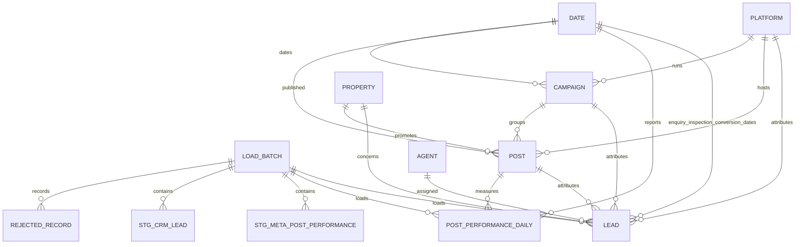

# Reporting database ERD

Relationships pointing to `LEAD` from platform, campaign, post, property and agent are optional. This preserves CRM leads that cannot be reliably attributed to a social post while allowing dashboard users to distinguish attributed and unattributed outcomes.
